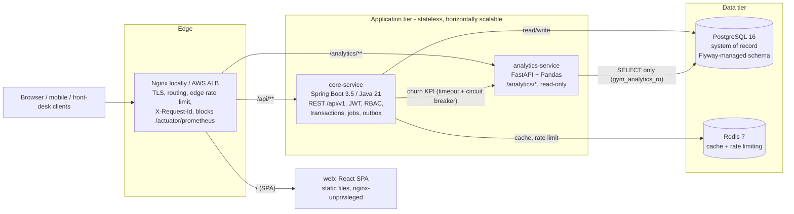
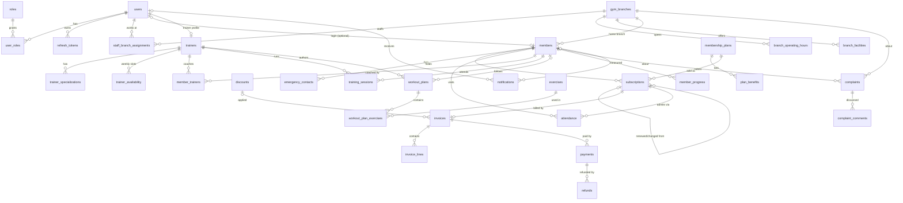
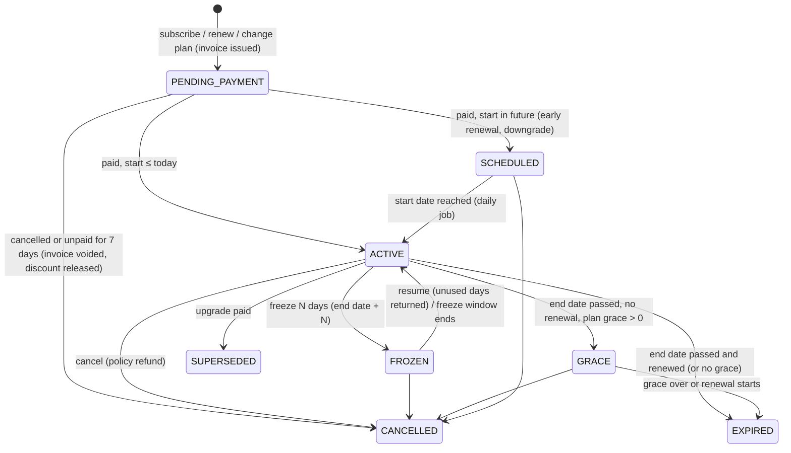
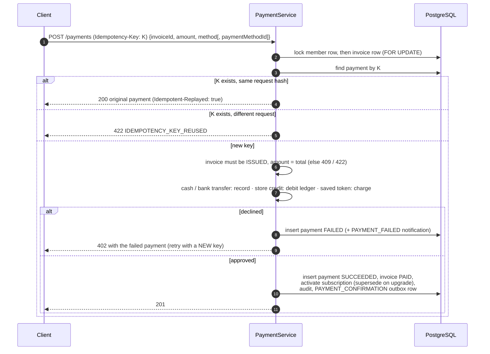
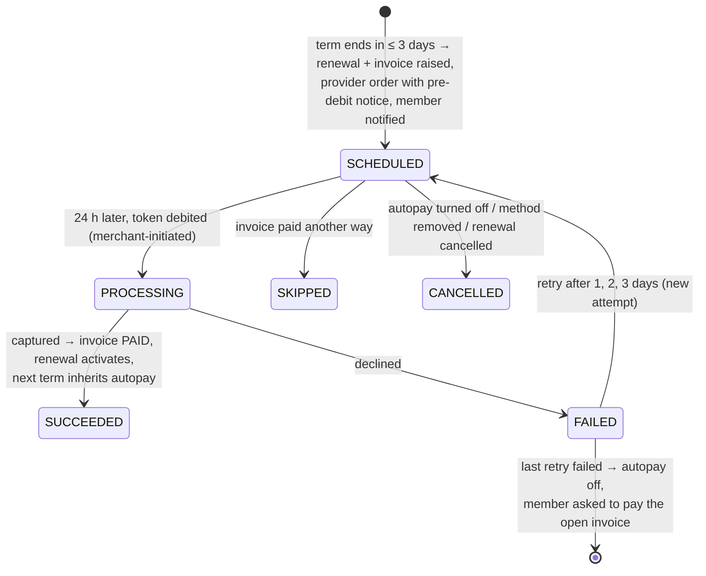
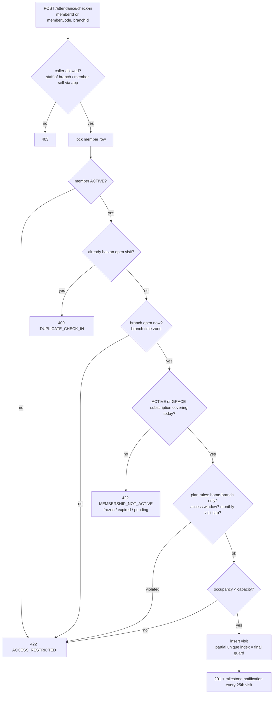
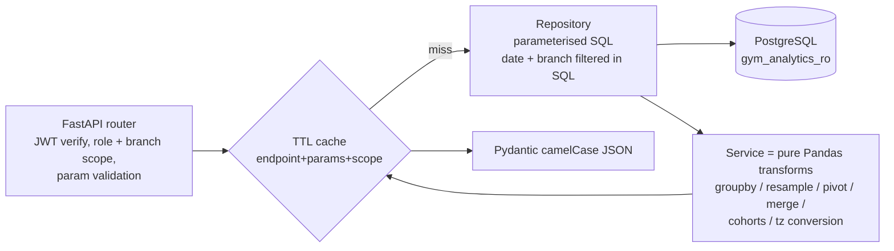
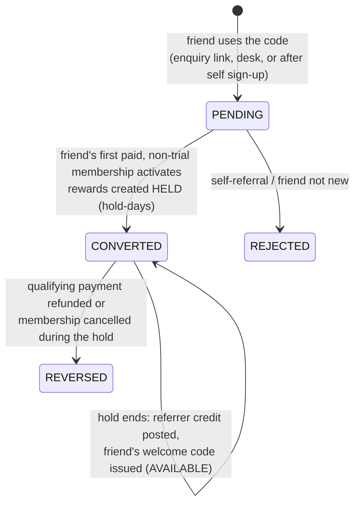
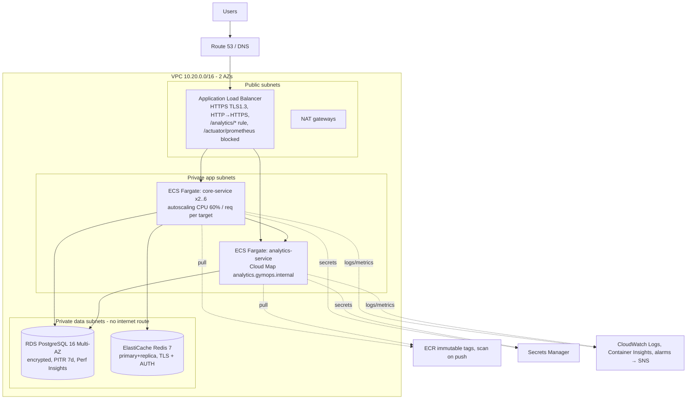

# GymOps: Gym Membership & Operations Platform

Non-technical setup guide: [docs/SETUP_GUIDE.md](docs/SETUP_GUIDE.md)

GymOps is a backend for a multi-branch gym business. It runs memberships, billing, front-desk check-in, trainers, workout programmes, member support and management analytics.

There are two services:

- **`core-service`**: the transactional system of record. Java 21, Spring Boot 3.5.
- **`analytics-service`**: a read-only analytics engine. Python 3.12, FastAPI, Pandas.

Both run on PostgreSQL and Redis behind Nginx (locally) or an AWS ALB (production). Everything in this README is implemented and was run.

| | |
|---|---|
| Java core | about 13k lines of source, about 115 REST endpoints, 33 tables in Flyway migrations |
| Python analytics | 10 analytics endpoints, about 3.9k lines, 121 pytest tests |
| Web frontend | React 19 + TypeScript + Mantine: staff console, trainer portal and member portal (25+ screens) |
| Tests | Java: 63 unit/slice + 29 Testcontainers integration tests. Python: 121. End-to-end smoke test: 84 checks. API sweep: ~240 calls as every role |
| Run it | `make up` → web app at http://localhost (Swagger at `/swagger-ui.html`) |

---

## Table of contents
1. [Business problem](#1-business-problem)
2. [Features](#2-features)
3. [Architecture](#3-architecture)
4. [Technology stack and why each piece is there](#4-technology-stack)
5. [Database design](#5-database-design)
6. [API](#6-api)
7. [Authentication and authorization](#7-authentication--authorization)
8. [Subscription lifecycle](#8-subscription-lifecycle)
9. [Payment workflow](#9-payment-workflow)
10. [Attendance workflow](#10-attendance-workflow)
    - 10a. [Access control & biometric gates](#10a-access-control--biometric-gates)
11. [Python analytics service](#11-python-analytics-service)
12. [Caching and Redis](#12-caching--redis)
13. [Notifications](#13-notifications)
    - [Referrals & retention campaigns](#referrals--retention-campaigns)
14. [Observability](#14-observability)
15. [Running locally with Docker](#15-running-locally-docker)
16. [Testing](#16-testing)
17. [CI/CD](#17-cicd)
18. [AWS deployment](#18-aws-deployment)
19. [Design decisions and trade-offs](#19-design-decisions--trade-offs)
20. [Scalability](#20-scalability)
21. [Known limitations and future improvements](#21-known-limitations--future-improvements)
22. [Web frontend](#22-web-frontend)

Interview Q&A lives in [`docs/INTERVIEW_PREP.md`](docs/INTERVIEW_PREP.md). The AWS runbook is in [`docs/AWS_DEPLOYMENT.md`](docs/AWS_DEPLOYMENT.md). What to build next is in [`docs/ROADMAP.md`](docs/ROADMAP.md). The web app is described in [section 22](#22-web-frontend).

---

## 1. Business problem

A gym chain with several branches needs one system to answer four kinds of question:

- **Front desk:** "Can this person walk in right now?" That depends on a valid membership, the plan's hours and branch rules, a monthly visit cap, opening hours, capacity, and whether they are already inside.
- **Billing:** "Charge this member exactly once," even with flaky networks and double-clicks. Also discounts, GST, prorated upgrades and refunds that follow each plan's cancellation policy.
- **Operations:** renewals, freezes, grace periods, expiry reminders, trainer schedules, complaints with SLAs, and a full audit trail.
- **Management:** retention, churn, revenue by plan and branch, peak hours, trainer utilisation, and which members are about to leave.

The first three are **transactional** and need strong consistency and concurrency safety. They live in the Java core. The fourth is **analytical**: large scans, time series and cohort maths. It lives in a separate Python service that only reads.

## 2. Features

| Module | What is implemented |
|---|---|
| **Auth & users** | JWT access tokens (15 min) and rotating opaque refresh tokens (14 days) with reuse detection; BCrypt hashing; account lockout; 6 roles; staff accounts with branch assignment; privilege-escalation guard; self-service member sign-up |
| **Branches** | CRUD, operating hours per weekday (in the branch's time zone), facilities, staff assignment, status, soft delete, branch-level authorization; GST registration (GSTIN with checksum validation, GST state code) |
| **Members** | Front-desk and self-service registration, emergency contacts, search/filter/sort/pagination (including "membership state" filter), member code lookup, status, soft delete, audit timeline |
| **Plans** | Monthly / Quarterly / Half-yearly / Annual / Custom-days; price, joining fee, benefits; access rules (all-branch vs home-branch, time window, monthly visit cap); freeze policy; cancellation policy (non-refundable / prorated / cooling-off); grace period; DRAFT→ACTIVE→ARCHIVED; Redis-cached catalogue; **scheduled price changes** with full price history, existing-member price protection ("grandfathering") and advance notice to autopay members |
| **Subscriptions** | Purchase, renewal (continuous), upgrade (immediate, prorated credit), downgrade (next term), freeze/resume (with queued-renewal shifting), cancellation with policy-based refund, grace period, expiry, scheduled start, stale-unpaid release, history; DB-enforced no-overlap |
| **Payments** | Invoices with lines (plan fee, joining fee, proration credit, price adjustment), negotiated prices at the point of sale (manager limit, audited), discounts (atomic redemption limit), GST; **GST tax invoice and credit note PDFs** (CGST+SGST / IGST, SAC 999723, amount in words), idempotent payment capture, declined-payment recording, full/partial refunds (idempotent, to the original method or to store credit), outstanding/overdue invoices, payment history |
| **Online payments** | Hosted checkout (Razorpay Checkout, or a signed simulator locally) for card, UPI, net banking, wallets and card EMI (3/6/9/12 months); server-side HMAC signature verification; signed, de-duplicated webhooks; automatic refund of a second capture on an already-paid invoice; saved cards / UPI handles as provider tokens with one-click payment; store credit (append-only ledger) |
| **Recurring billing (autopay)** | Mandate set up during checkout; renewal invoice raised 3 days before the term ends; pre-debit notice 24 h before every debit; merchant-initiated token debit; retries after 1, 2 and 3 days, then autopay switches off and the member is asked to pay manually; asynchronous debits settled by webhook; autopay carries over to the next term and to plan changes |
| **Attendance** | Check-in by id or member code, check-out, duplicate prevention (DB + lock), plan/branch/time/visit-cap/capacity/opening-hours rules, live occupancy, daily branch summary, member history, auto check-out job |
| **Access control** | Turnstile / door / kiosk devices with HMAC-signed device API (nonce + skew + response signatures), RFID cards, on-device biometric matching (only template references stored) with DPDP consent and withdrawal, rotating single-use QR pass, decisions through the shared attendance rules, anti-passback, signed offline allowlist and reconciliation, alarms and offline-device alerts, browser gate simulator |
| **Trainers** | Profiles, specialisations, weekly availability, client assignment (capacity limit), session booking inside availability with DB-enforced no double booking, session outcomes, schedule, performance counts |
| **Workouts** | Exercise catalogue, templates, per-member copies (personalisable), sets/reps/weight/duration/rest, trainer notes, progress measurements |
| **Notifications** | 18 event types via a transactional outbox; IN_APP + EMAIL channels behind a sender interface; retries with exponential backoff; de-duplication keys; inbox API |
| **Complaints** | Categories, priorities, state machine, assignment, comments (internal / public), manual + automatic SLA escalation, reopen with a fresh SLA window, audit history |
| **Dashboards** | Admin KPIs (Redis-cached, churn pulled from analytics with graceful degradation), trainer dashboard, member dashboard |
| **Referrals** | Stable per-member referral codes (`ASHA7K2`) and share links (`/enquire?ref=CODE`), public code lookup, codes at the desk or after self sign-up; on the friend's first paid membership the referrer earns store credit and the friend a single-use personal discount code; rewards held 14 days and reversed on refund / cancellation; no self-referral, new customers only, monthly cap per referrer |
| **Retention campaigns** | Win-back / renewal campaigns on five segments (churn-risk band from analytics, expiring without autopay, lapsed 7–90 days, no recent visit, trial not converted), templated messages with live preview, optional single-use personal offer codes, run now or daily / weekly (ShedLock), per-member cooldown, last-touch attribution with conversion and revenue stats |
| **Analytics (Python)** | Attendance trends, peak-hour heatmap and occupancy, revenue (gross/refunds/net, by plan/branch/method), retention cohorts, engagement segments, renewal and churn rates, expiry pipeline, rule-based churn-risk, trainer utilisation, branch ranking |

## 3. Architecture



**Request path:** client → Nginx/ALB → core (JWT filter → `@PreAuthorize` role check → service → branch/ownership check in `AccessPolicy` → transaction) → PostgreSQL. The analytics service checks the **same JWT** and applies the **same branch scoping** on its own.

**Code layout (core):** package-by-feature (`member`, `subscription`, `payment`, ...). Each feature has the same layers: `Controller` (HTTP and validation) → `Service` (transactions and orchestration) → rich `Entity` (invariants and state transitions) → `Repository` (Spring Data JPA). DTOs are Java records. Cross-cutting concerns live in `common` (error envelope, constraint mapping, correlation ID, money), `security`, `audit` and `config`. Modules talk through **domain events** (e.g. `PaymentSucceeded` → notification) and **ports** (`PaymentGateway`, `PaidInvoiceHandler`, `NotificationSender`), which keeps billing independent of subscription rules and of any payment provider.

```
core-service/src/main/java/com/gymops
├── auth/          login, register, refresh rotation, logout
├── user/          users, roles, staff administration
├── security/      JWT, filters, AccessPolicy (row-level rules), rate limiter
├── branch/        branches, hours, facilities, staff assignment
├── member/        members, emergency contacts, search specs, cached profile
├── plan/          membership plans (cached)
├── subscription/  lifecycle, proration & refund policy, daily job
├── payment/       invoices, discounts, payments, refunds, gateway port
├── attendance/    check-in/out, occupancy, auto check-out job
├── trainer/       trainers, availability, assignments, sessions
├── workout/       exercises, templates, member plans, progress
├── complaint/     tickets, state machine, SLA escalation job
├── notification/  outbox, dispatcher, channel senders, inbox
├── dashboard/     admin / trainer / member dashboards, analytics client
├── audit/         append-only audit log
├── bootstrap/     first super-admin, optional demo dataset
└── common, config
```

## 4. Technology stack

| Technology | Why it is in the system |
|---|---|
| **Java 21 + Spring Boot 3.5** | Transactional core: declarative transactions, mature JPA/Hibernate, Spring Security, validation, Actuator. Virtual threads are enabled for request handling. |
| **Spring Data JPA / Hibernate** | Rich domain entities with optimistic locking (`@Version`), pessimistic row locks for critical paths, Specifications for dynamic filters. `ddl-auto=validate`, so the schema is owned by Flyway. |
| **PostgreSQL 16** | ACID transactions plus features this design depends on: **GiST exclusion constraints** (no overlapping subscriptions / sessions), **partial unique indexes** (one open visit, one pending subscription, one settled payment per invoice), `SELECT … FOR UPDATE SKIP LOCKED` (outbox), `jsonb` (audit details), sequences (invoice / member / ticket numbers). |
| **Flyway** | Versioned, reviewable schema migrations; the same SQL runs locally, in CI (Testcontainers) and in RDS. |
| **Redis 7** | Shared cache (plans, member profiles, admin dashboard) and **distributed rate limiting** (atomic Lua INCR+PEXPIRE). Optional at runtime: failures degrade to the database and fail open. |
| **Spring Security + JJWT** | Stateless HS256 access tokens carrying roles and branch IDs; BCrypt via a delegating encoder. |
| **ShedLock** | Scheduled jobs run on every instance's scheduler, but only one instance executes each run (lock row in PostgreSQL). |
| **Resilience4j** | Circuit breaker plus timeouts on the core→analytics call. |
| **Micrometer / Prometheus, Logstash encoder** | Metrics (`/actuator/prometheus`, business counters) and JSON logs with correlation ID. |
| **springdoc-openapi** | Swagger UI and OpenAPI 3 spec generated from the controllers. |
| **Python 3.12, FastAPI, Pandas, SQLAlchemy 2 / psycopg 3** | Analytics: SQL extraction, then Pandas transforms (groupby, resample, pivot, cohort, time-zone conversion), served as JSON. |
| **Docker / Compose, Nginx** | One-command reproducible environment; Nginx as reverse proxy, path router and edge rate limiter. |
| **Testcontainers, JUnit 5, Mockito, MockMvc, pytest** | Real PostgreSQL/Redis in integration tests; fast unit and slice tests. |
| **Checkstyle, SpotBugs, JaCoCo, Ruff, hadolint, Trivy** | Static analysis, coverage, Dockerfile lint and image scanning in CI. |
| **GitHub Actions (and a Jenkinsfile)** | CI/CD pipeline; OIDC to AWS (no static keys). |
| **Terraform → AWS** | VPC, ALB, ECS Fargate, RDS, ElastiCache, ECR, Secrets Manager, Cloud Map, CloudWatch alarms. |

## 5. Database design

Schema: [`V1__core_schema.sql`](core-service/src/main/resources/db/migration/V1__core_schema.sql). Reference data: `V2`. Analytics read grants: `V3`.



Invariants enforced **by the database**, so they hold under any concurrency or manual SQL:

| Invariant | Mechanism |
|---|---|
| A member never holds two committed subscriptions with overlapping dates | `EXCLUDE USING gist (member_id WITH =, daterange(start,end,'[]') WITH &&) WHERE status IN (SCHEDULED, ACTIVE, FROZEN, GRACE)` |
| At most one unpaid subscription per member | partial unique index `WHERE status = 'PENDING_PAYMENT'` |
| One open visit per member, across all branches | partial unique index `attendance(member_id) WHERE check_out_time IS NULL` |
| An invoice is settled by exactly one payment | partial unique index on `payments(invoice_id) WHERE status IN (SUCCEEDED, PARTIALLY_REFUNDED, REFUNDED)` |
| A payment request is processed once | `payments.idempotency_key UNIQUE` (and `refunds.idempotency_key UNIQUE`) |
| Trainer / member cannot be double-booked | two GiST exclusion constraints on `tstzrange(starts_at, ends_at)` |
| One active trainer / one active workout plan per member | partial unique indexes |
| Money and plan sanity | CHECK constraints (non-negative amounts, refunded ≤ paid, discount ≤ subtotal, valid freeze policy, custom-plan duration ...) |

Other conventions:

- **Types and indexes:** `bigint` identity keys; `timestamptz` for instants; `date` for business dates; `numeric(12,2)` for money; enums as `varchar` with CHECK constraints. Indexes follow the access paths (member + date, branch + time, status + end date, SLA due date, outbox `next_attempt_at`).
- **Soft deletion:** users, branches, members and trainers (`deleted_at` plus Hibernate `@SQLRestriction`). Unique indexes on email and code are *partial* (`WHERE deleted_at IS NULL`), so a deleted member can register again.
- **Auditing columns:** `created_at/updated_at/created_by/updated_by` via Spring Data auditing.
- **Optimistic locking:** `version` on aggregates.
- **Business timeline:** `audit_logs` (append-only, `jsonb` details, correlation ID).

## 6. API

All endpoints are versioned under `/api/v1`. Swagger UI is at `/swagger-ui.html` and the OpenAPI spec at `/v3/api-docs`.

| Resource | Endpoints (abridged; full list in Swagger) |
|---|---|
| `/auth` | `POST login, register, refresh, logout, logout-all, change-password` |
| `/users` | `GET/PUT me`, `GET /`, `GET /{id}`, `POST /` (staff), `PATCH /{id}/status`, `PUT /{id}/roles`, `DELETE /{id}` |
| `/branches` | `GET /public`, CRUD, `PATCH /{id}/status`, `PUT /{id}/operating-hours`, facilities CRUD, staff assign/unassign/list |
| `/members` | search (`q, branchId, status, membership, registeredFrom/To, page, size, sort`), `POST`, `GET /me`, `GET /{id}`, `GET /code/{code}`, `PUT /{id}`, `PATCH /{id}/status`, `DELETE /{id}`, `GET /{id}/history` |
| `/plans` | `GET /` (public, cached), `GET /{id}`, `GET /admin`, `POST`, `PUT /{id}`, `PATCH /{id}/status` |
| `/subscriptions` | `POST /`, `GET /{id}`, search, `GET /members/{id}`, `POST /{id}/renew`, `/change-plan`, `/freeze`, `/resume`, `/cancel`, `POST /lifecycle/run` |
| `/payments` | `POST /` (**Idempotency-Key**), `GET /{id}`, history search, `POST/GET /{id}/refunds`, `GET /invoices`, `/invoices/outstanding`, `/invoices/{id}`, `GET /invoices/{id}/pdf`, `GET /refunds/{id}/credit-note.pdf`, discounts |
| `/pricing` | `GET /plans/{id}/history`, `POST /plans/{id}/changes` (schedule), `POST /plans/{id}/changes/preview`, `POST /changes/{id}/cancel`, `GET /changes/scheduled`, `GET /settings`, `POST /run` |
| `/attendance` | `POST check-in`, `check-out`, `GET /members/{id}`, `GET /branches/{id}`, `/daily-summary`, `/occupancy` |
| `/trainers` | search, CRUD, `PUT /{id}/availability`, clients assign/list/end, sessions book/update, `/schedule`, `/performance` |
| `/workouts` | exercises, templates, `POST /templates/{id}/assign`, plans get/update/complete, member active plan, plans, progress |
| `/complaints` | create, search, get, `PATCH assignee`, `PATCH status`, `POST escalate`, comments, `GET history` |
| `/notifications` | inbox, unread count, mark read / all read, admin outbox view + retry |
| `/dashboard` | `GET admin`, `trainer`, `member` |
| `/referrals` | `GET /me`, `POST /me/claim` (member); `POST /` attach code at the desk, `GET /` (branch-scoped), `GET /{id}`, `GET /stats`, `GET /settings`, `GET /members/{id}`; public `GET /api/v1/public/referrals/{code}` |
| `/campaigns` | CRUD, `POST /preview` (unsaved), `POST /{id}/preview`, `/{id}/run`, `/activate`, `/pause`, `/archive`, `GET /{id}/runs`, `GET /{id}/recipients`; `POST /api/v1/growth/jobs/run` (admins) |

**Conventions**

- **Pagination:** `?page=0&size=20&sort=lastName,desc`. Sort fields are whitelisted per endpoint and `size ≤ 100`. Responses use `{content, page, size, totalElements, totalPages, last}`.
- **Status codes:** `201` + `Location` on create; `204` on delete; `400` validation; `401` not authenticated; `402` payment declined (the failed attempt is still recorded); `403` role or branch denied; `404`; `409` conflicts and invalid state transitions; `422` business-rule violations; `423` locked account; `429` rate limited; `503` dependency unavailable.
- **Error envelope** (identical in both services):

```json
{ "timestamp": "2026-10-05T18:54:07Z", "status": 409, "error": "Conflict", "code": "DUPLICATE_CHECK_IN",
  "message": "Member is already checked in (visit 812 at branch 4 since ...)", "path": "/api/v1/attendance/check-in",
  "correlationId": "4f0c...", "violations": [ { "field": "email", "message": "must be a well-formed email address" } ] }
```

Clients branch on `code`, never on `message`. Database constraint violations are translated into these codes by `DatabaseConstraints`.

## 7. Authentication & authorization

```mermaid
sequenceDiagram
    autonumber
    participant C as Client
    participant A as core /auth
    participant DB as PostgreSQL
    C->>A: POST /login {email, password}
    A->>DB: load user (+roles); check lock; BCrypt verify
    alt wrong password
        A->>DB: failed_login_attempts++ (lock 15 min after 5)
        A-->>C: 401 INVALID_CREDENTIALS
    else ok
        A->>DB: load branch assignments / memberId / trainerId
        A->>DB: store SHA-256(refresh token), new family_id
        A-->>C: accessToken (JWT, 15 min) + refreshToken (opaque, 14 days)
    end
    C->>A: API call with Authorization: Bearer JWT (no DB lookup)
    C->>A: POST /refresh {refreshToken}
    A->>DB: SELECT ... FOR UPDATE by hash
    alt token already rotated (reuse = likely theft)
        A->>DB: revoke whole family
        A-->>C: 401
    else valid
        A->>DB: revoke old (ROTATED), insert new in same family
        A-->>C: new access + refresh token
    end
```

- **Access token:** HS256 JWT with `sub, email, roles, branches, memberId, trainerId, typ=access, iss, aud, jti, exp`. Each request is authenticated statelessly from these claims. The analytics service verifies the same token with the shared secret.
- **Refresh token:** a 256-bit random value. Only its SHA-256 hash is stored. It rotates on every use; reusing an old one revokes the whole session family. Logout revokes the family, and logout-all revokes every family. Password change, disable, delete and role change all revoke refresh tokens, so new roles or branches take effect on the next login.
- **Brute-force protection:**
  - Per-account lockout: 5 failures → 15 minutes.
  - Per-IP Redis rate limit on `login/register/refresh`: 20/min.
  - Nginx edge limits: `/api` 30 r/s, `/api/v1/auth` 5 r/s, `/analytics` 5 r/s.
  - Unknown emails take the same BCrypt time as known ones.
- **Password policy:** 10–72 characters with upper case, lower case and a digit. Stored as `{bcrypt}…` through a delegating encoder, so the algorithm can be upgraded.

**RBAC in two layers:**

1. **Role layer:** `@PreAuthorize` on every controller method. For example, a receptionist cannot create plans and a member cannot list members.
2. **Data layer:** `AccessPolicy` inside services.

| Role | Scope |
|---|---|
| SUPER_ADMIN | everything, incl. admin accounts, role changes, lifecycle trigger, outbox admin |
| GYM_ADMIN | all branches: branches, plans, discounts, staff (cannot create SUPER_ADMIN/GYM_ADMIN) |
| MANAGER | assigned branches: members, subscriptions, refunds, trainers, complaints, dashboards, analytics |
| RECEPTIONIST | assigned branches: register members, sell subscriptions, record payments, check-in/out |
| TRAINER | own profile, availability, own clients' workout plans, progress and sessions |
| MEMBER | own profile, membership, online payment (CARD/UPI only), check-in via app/QR, complaints, dashboard |

Branch scoping is enforced on single-resource access (403) and applied as a filter on list queries. Members only ever see their own records; other members' complaints return 404, which avoids revealing that they exist.

## 8. Subscription lifecycle



Business rules:

- **Terms are inclusive.** Monthly from 10 Mar runs to 9 Apr; custom plans run N days. The price is snapshotted onto each subscription term, so a price change never alters a term already sold; what the *next* term (renewal) costs is decided by the pricing rules below.
- **Renewal** starts the day after the current end date, so membership is continuous. Paid during grace, it stays back-dated so there is no gap. Renewing an EXPIRED subscription starts today. You cannot renew twice.
- **Upgrade vs downgrade** is decided by contract value:
  - New plan price > current term price: an **upgrade**, effective immediately once paid. The unused paid days of the current term are credited as a `PRORATION_CREDIT` invoice line, and the old subscription becomes `SUPERSEDED`.
  - Otherwise a **downgrade**, starting at the next term with no credit.
  - Example: Monthly → Annual is an upgrade.
- **Freeze** follows the plan's policy (allowed, min/max days, count per term). Freezing extends the end date. Queued renewals are **shifted forward** in the same transaction, latest first, so no intermediate overlap occurs. Resuming early shrinks both back.
- **Cancellation refund** (`CancellationRefundCalculator`):
  - `NON_REFUNDABLE` → 0.
  - `PRORATED` → `paid × unusedPaidDays / paidDays − cancellationFee`.
  - `COOLING_OFF_FULL_REFUND` → full refund within N days of activation, prorated afterwards.
  - Frozen days are not counted as paid days, and the result is capped at the refundable balance.
- **Daily job** (00:05 business time, one instance via ShedLock, one transaction per subscription, idempotent):
  - start scheduled terms → auto-resume ended freezes → move ended terms to GRACE or EXPIRED → release stale unpaid → queue 7-day renewal reminders and 1-day expiry warnings (de-duplicated).
  - It can also be triggered with `POST /subscriptions/lifecycle/run`.

**Concurrency:** every mutating subscription operation first takes `SELECT … FOR UPDATE` on the **member row**, so all membership changes for one member are serialised. The same holds for payments: member row first, then invoice row. This fixed lock order prevents deadlocks. `@Version` adds optimistic protection, and the exclusion constraint is the final guarantee. `ConcurrencyIT` fires 12 simultaneous renew/upgrade requests at one subscription and asserts exactly one wins (`201`) while the rest get `409`.

### Pricing changes & price protection

Owners change what a plan costs through **Change price** on the plan card (`POST /api/v1/pricing/plans/{id}/changes`, managers and admins): a new price and/or joining fee, an **effective date** (today or up to a year ahead), a **reason**, and a policy for **existing members**. A preview (`.../changes/preview`) lists the open subscriptions, the autopay members affected and, for each, the projected first debit at the new price. One change can be pending per plan; it can be cancelled until it takes effect (members already notified are told).

- **History.** Every scheduled, applied and cancelled change, and every immediate price edit through `PUT /plans/{id}` (`priceChangeReason`), is kept in `plan_price_changes` with who / when / old / new / effective date (`GET /api/v1/pricing/plans/{id}/history`). Old values are re-captured when a change is applied.
- **Applying.** `PriceChangeJob` (hourly, ShedLock) writes due changes to the plan and evicts the Redis plan caches; sales are priced lazily too, so a sale on the effective date pays the new price even before the job runs.
- **Direct edits** are blocked while a change is scheduled (409) and for **increases on plans with autopay members** (422): those must be scheduled, so members get notice and a policy.

**Which price applies** (`PriceResolver`, pure and unit-tested):

| Sale | Price |
|---|---|
| New subscription | The plan's list price on the sale date (a due scheduled change counts). A manager may sell at a **negotiated price** instead (below). |
| Renewal of the same plan (manual or autopay) | The lowest of: list price on the invoice date; the member's **negotiated price** if it is kept on renewals; their **protected price** if the renewal term starts on or before their protection date. |
| Renewal onto another plan / plan change | That plan's list price (a new purchase). |
| **Autopay** renewal that costs more than the member's current term | Only if a notice announcing at least that price was sent `app.pricing.price-change-notice-days` (default 7) before the debit; **otherwise that renewal is charged at the member's current price** (`NOTICE_HELD`, shown as a "Price held" line) and the new price applies from the following renewal. Nothing is postponed and no member is ever debited an amount they were not told about. |

- **Existing-member policy.** `NEW_PRICE_AT_RENEWAL`: members pay the new price from their first renewal invoiced on/after the effective date (autopay members subject to the notice rule). `PROTECT_EXISTING` (increases only): members who held the plan before the change took effect (before the start of the effective date, or before the change was scheduled when it is effective today) keep their current price for renewals whose term starts on or before `protectMonths` / `protectUntil`. When the change is applied their subscriptions get `locked_price` / `price_protected_until` (one bulk update that bumps `version`, so a concurrent edit fails instead of overwriting the lock); renewals carry the lock forward until it expires. A member already protected at a lower price keeps that price and the later of the two dates.
- **Notice to autopay members.** Scheduling an increase sends a `PLAN_PRICE_CHANGED` notification (in-app + email via the outbox) to every autopay member of the plan whose renewal will cost more, with the old and new price, the reason, any protection date and the projected first debit date, and records it in `price_change_notices`. A safety-net sweep in the same hourly job notifies autopay members whose next renewal costs more for any other reason (protection or a one-term negotiated price ending, autopay switched on later) in time for the renewal when possible, and says so when it is not. Members can switch autopay off at any time.
- **Negotiated price at the point of sale.** `POST /subscriptions` accepts `customPrice`, a mandatory `customPriceReason` and `keepCustomPriceOnRenewal`. Managers may give at most `app.pricing.max-override-discount-pct` (default 50%) off the list price; gym and super admins are not limited; receptionists and members cannot (403). It cannot be combined with a discount code. The invoice shows the plan fee at list price plus a separate **"Negotiated price adjustment"** line, so subtotal, discount and GST stay correct; the sale is audited (`PRICE_OVERRIDDEN`). With "keep on renewals" the renewals keep the negotiated price (never above the list price).
- Subscriptions expose `priceBasis` (`LIST`, `NEGOTIATED`, `PRICE_PROTECTED`, `NOTICE_HELD`), `listPrice`, `lockedPrice` and `priceProtectedUntil`. `PricingIT` covers scheduling and history, lazy application and cache eviction, protection vs new sales, the autopay notice rule (on time and late), override limits and roles.

## 9. Payment workflow

Payments come in through four channels. All of them end in the same `PaymentRecorder`, which writes the payment, settles the invoice and activates the subscription in one transaction, under the member and invoice row locks:

| Channel | Endpoint | Methods |
|---|---|---|
| At the desk (staff only) | `POST /api/v1/payments` | `CASH`, `BANK_TRANSFER` (receipt / UTR reference) |
| Store credit | `POST /api/v1/payments` | `STORE_CREDIT` (debits the member's ledger) |
| Saved method, one click | `POST /api/v1/payments` with `paymentMethodId` | saved `CARD` / `UPI` token |
| Hosted checkout | `POST /api/v1/payments/checkout`, then `.../checkout/{id}/confirm` | `CARD`, `UPI`, `NET_BANKING`, `WALLET`, `EMI` |
| Autopay | hourly job | saved `CARD` / `UPI` token with an active mandate |

### Direct payments (idempotent)



- **Idempotency is layered.** Request hash per key; lookup under the invoice lock; `UNIQUE(idempotency_key)`; at most one settled payment per invoice (partial unique index); one row per provider payment id (`UNIQUE(provider, gateway_reference)`). `ConcurrencyIT` verifies two cases:
  - 12 concurrent retries with the same key → exactly one charge, all responses carry the same payment ID.
  - 12 concurrent attempts with different keys on the same invoice → one `201` and eleven `409`.
- **Atomic.** Payment, invoice, subscription activation, audit entry and notification commit or roll back together. If activation would overlap another committed term, the exclusion constraint rejects it and the whole payment rolls back.
- **Invoices.**
  - Lines: plan fee, joining fee on a member's first-ever activation, proration credit.
  - Discount on the subtotal, then GST (`app.billing.tax-rate`, default 18%) with `HALF_UP` rounding. Pure logic, unit tested.
  - Zero-total invoices (e.g. 100% discount) settle without a payment.
  - Discount redemption is an atomic conditional `UPDATE`, so limits can't be exceeded under concurrency (tested with 20 parallel redemptions against a limit of 5).

### Hosted checkout (card, UPI, net banking, wallet, EMI)

```mermaid
sequenceDiagram
    autonumber
    participant B as Browser
    participant API as CheckoutService
    participant RP as Razorpay (or simulator)
    B->>API: POST /payments/checkout {invoiceId, method, saveMethod, setupAutopay}
    API->>RP: create order (amount in paise; customer + token mandate block if saving)
    API-->>B: intentId, orderId, public key id, prefill
    B->>RP: Razorpay Checkout (card / UPI details go only to Razorpay)
    RP-->>B: payment_id, order_id, signature
    B->>API: POST /checkout/{id}/confirm
    API->>API: verify HMAC-SHA256(order_id|payment_id, key secret), fetch payment
    API->>API: record payment, save token, enable autopay (one transaction)
    RP--)API: webhook payment.captured (HMAC of raw body)
    API->>API: already recorded → no-op
```

- **Never trust the browser.** Nothing is recorded until the signature verifies and the payment has been fetched from the provider. Amounts are compared in minor units.
- **Callback and webhook race safely.** Whichever arrives first records the payment; the other finds the intent `SUCCEEDED` (member lock + `UNIQUE(provider, gateway_reference)`). Webhook events are stored with `UNIQUE(provider, event_id)`, so redeliveries are no-ops. A webhook that fails is answered with 500 and logged as FAILED, so the provider redelivers it and it is processed again.
- **A failed attempt** is recorded as a FAILED payment, and the same checkout can be retried on the same order, as Razorpay Checkout allows.
- **Double payment** (two tabs, two methods): the second capture finds the invoice already PAID and is refunded automatically.
- **EMI** is offered on invoices of at least `app.payments.emi-min-amount` (default ₹3,000), with 3/6/9/12-month tenures. The tenure is stored on the payment.
- **The simulator** (`PAYMENT_GATEWAY=simulated`, the default) is stateless: the outcome, instrument and token are encoded in a compact payment id, signed together with the order id exactly like Razorpay signs checkout results. So the real verification path runs locally and in CI, with no network. The web app shows a "test mode" checkout page with test cards and the `success@razorpay` / `failure@razorpay` UPI IDs.
- **Razorpay** (`PAYMENT_GATEWAY=razorpay` plus `RAZORPAY_KEY_ID`, `RAZORPAY_KEY_SECRET`, `RAZORPAY_WEBHOOK_SECRET`) is an adapter over the REST API, using the Orders, Customers, Tokens and `/payments/create/recurring` endpoints. It is unit-tested against a mocked Razorpay API (`RazorpayGatewayTest`) but **has not been run against a live Razorpay account from this repository**. The webhook URL is `/api/v1/webhooks/razorpay`; subscribe to `payment.captured`, `payment.failed`, `token.confirmed`, `token.paused`, `token.cancelled` and `token.rejected`. Payments are always refunded through the provider that took them, so switching gateways never strands old payments.

### Saved methods, store credit and refunds

- **Saved methods** (`/api/v1/members/{id}/payment-methods`) hold only the provider token plus display data (brand, last 4, expiry, masked VPA). There is one default per member (partial unique index). Removing a method also switches off any autopay using it and cancels its scheduled debits.
- **Store credit** (`/api/v1/members/{id}/credit`) is an append-only ledger. Each row stores the running balance, written under the member lock, and the database rejects a negative balance. Managers issue or correct credit; members spend it on invoices.
- **Refunds** go to the original method (through the provider; cash and bank transfers are handed back at the desk) or to store credit. Money paid from store credit always returns to store credit. Refunds lock the member row and then the payment row, the same order as every other money operation.

### Recurring billing (autopay)



- **Setup:** pay once online with "Renew my membership automatically". The checkout registers a recurring token with a mandate (up to `app.payments.mandate-max-amount` per debit, default ₹50,000). Autopay can be switched on or off at any time from the membership page (`PUT /api/v1/subscriptions/{id}/autopay`).
- **Job:** `AutopayJob` runs hourly under ShedLock, one item per transaction. Admins can run it now with `POST /api/v1/autopay/run`.
  - **Timing:** `lead-days`, `pre-debit-notice` and `retry-delays-days` are all configurable.
  - **Debit outcome:** a debit whose outcome the provider reports later stays PROCESSING until the webhook settles it. A timeout or 5xx is treated the same way, never as a failure, so a debit is never retried twice.
- **Dunning:** each failure sends a notice with the retry date. Retries are also scheduled with the provider's pre-debit notification. The renewal stays protected from the "stale unpaid" sweep while retries are pending. Managers can retry the latest failed debit now (`POST /api/v1/autopay/attempts/{id}/retry`).
- **Mandate events** from the bank (`token.cancelled` / `paused` / `rejected`) switch autopay off and notify the member.
- `PaymentsV2IT` covers checkout and signatures, retries, duplicate-capture refunds, webhooks, autopay success, dunning and switch-off, method removal, one-click payment, store credit and EMI end to end against PostgreSQL.

### GST invoices & credit notes

- **Tax invoice PDF:** `GET /api/v1/payments/invoices/{id}/pdf` (OpenPDF). It shows the legal business name (`app.pricing.legal-business-name`), branch address, the branch **GSTIN** and GST state, invoice number and date, due date, status, place of supply, the member's billing details, line items with **SAC 999723** (fitness / health club services), discount, taxable value, **CGST + SGST** (each half the rate) when the place of supply is in the branch's state or **IGST** when it is not, the total in words (Indian system: lakh, crore), and the payment and credit-note history. The place of supply is the state on the member's address when one is on record, else the branch's state.
- **GST registration:** branches have an optional `gstin` (format, state code and mod-36 check character validated in the API, form and database) and `gstStateCode` (taken from the GSTIN, else entered, else derived from the branch's state name). Invoices capture GSTIN, supplier state, place of supply and SAC when they are issued, so a later change never alters an invoice already given to a member (older invoices render from the current registration).
- **Credit notes:** every refund gets a number from its own series (`CN-yyyy-nnnnnn`, existing refunds are numbered by the migration). `GET /api/v1/payments/refunds/{id}/credit-note.pdf` references the original invoice and splits the tax-inclusive refund into taxable value and CGST/SGST or IGST.
- **Access:** members can download only their own documents; front-desk staff, managers and admins only for the branches they can access (trainers cannot). Responses carry `Content-Disposition: attachment; filename="INV-….pdf"` and `Cache-Control: no-store, private`. The web app downloads them with the bearer token (fetch → blob) from Billing, the member's Billing tab and the member's Payments page.
- The document model (`TaxDocumentFactory`) is pure and the renderer is tested by extracting the PDF text (`TaxDocumentTest`); `PricingIT` checks content type, headers, content and authorization over HTTP.

## 10. Attendance workflow



- **Check-out** locks the open visit, so it can't be closed twice.
- **Auto check-out:** a job every 15 minutes closes visits open longer than 12 h, assuming a 90-minute visit. Those visits are flagged `auto_checked_out` and excluded from visit-duration analytics.
- **Operational endpoints:** live occupancy, daily branch summary (check-ins, unique members, inside now, average visit) and member history.
- **Metrics:** check-ins and denials by reason (`gymops.checkins`, `gymops.checkins.denied`).
- **Tests:** `ConcurrencyIT` sends 12 simultaneous check-ins for one member and gets exactly one visit.

## 10a. Access control & biometric gates

Members can enter through turnstiles, doors and kiosks with an **RFID card**, a **fingerprint / face** or the **rotating QR pass** in the member app. The gate asks the server for every decision, and the server applies the **same rules as front-desk check-in**. `AttendanceService.evaluateEntry` is the single rule engine for both paths (member status, open visit, opening hours, access-granting subscription, plan branch / time window / visit cap, capacity). A granted entry creates the attendance visit (`check_in_method = GATE`) and a granted exit closes it.

> **Honesty note.** No physical gate hardware was integrated. The device API is vendor-neutral. A ZKTeco / eSSL / Suprema installation needs a small **vendor bridge** that turns the vendor SDK's events (card read, fingerprint match, door sensor) into these signed requests. The web **gate simulator** and `scripts/gate_simulator.py` speak the same protocol and were used to exercise it end to end.

```mermaid
sequenceDiagram
    autonumber
    participant M as Member
    participant G as Gate (firmware / vendor bridge)
    participant API as core /api/v1/access/gate
    participant DB as PostgreSQL
    M->>G: tap card / finger / show QR
    Note over G: biometric matching happens ON the device;<br/>only the matched template reference leaves it
    G->>API: POST /events {deviceEventId, credentialType, credentialValue, direction}<br/>X-Device-Id, X-Timestamp, X-Nonce, X-Signature
    API->>API: verify HMAC, |skew| ≤ 5 min, burn nonce (DB, single use)
    API->>DB: same deviceEventId already logged? → return the stored decision
    API->>DB: resolve credential (SHA-256 of card UID / template ref, or QR MAC)
    API->>DB: lock member row (same lock order as desk check-in)
    API->>API: shared entry rules + anti-passback
    API->>DB: insert/close attendance visit, append access_events row (one transaction)
    API-->>G: {decision GRANTED/DENIED, reasonCode, openSeconds} + response X-Signature
    G-->>M: OPEN (green) / DENIED + reason
```

**Device security model**

- Every request carries `X-Device-Id`, `X-Timestamp` (epoch seconds), `X-Nonce` and `X-Signature = hex(HMAC-SHA256(secret, METHOD|PATH?QUERY|timestamp|nonce|hex(SHA-256(body))))`. Requests are refused with 401 for a bad or missing signature, an unknown device, a clock skew above 5 minutes or a replayed nonce, and with 403 for a disabled device. The nonce is burned only after the signature verifies, so an attacker cannot use up a device's nonces.
- **Replay protection lives in PostgreSQL**, not Redis (`access_replay_guard`, `INSERT … ON CONFLICT DO NOTHING`). Redis is optional in this system and fails open; a security control must not.
- **Device secrets are derived, never stored:** `secret = HMAC-SHA256(ACCESS_MASTER_KEY, "device|" + uid + "|" + keyVersion)`. The database keeps only the public uid and the key version, so a database dump alone cannot forge gate traffic. The secret is shown once, on create or rotate. Rotation increments the version, and the old secret stops verifying immediately. The trade-off is that whoever holds the master key can recompute every device secret, which is the same exposure as with encrypt-at-rest. Rotating the master key means re-provisioning every gate. `ACCESS_MASTER_KEY` (32 or more characters) is required under the `prod` profile; other profiles fall back to a fixed development key and log a warning.
- **Responses are signed back** (`X-Signature = HMAC(secret, "response|" + nonce + "|" + SHA-256(body))`), so a gate only opens on a genuine GRANTED and can trust the allowlist it downloaded.
- **Decisions are idempotent:** `UNIQUE(device_id, device_event_id)` plus a re-check after the member lock. A retried or duplicated event returns the original decision (`replayed: true`) and never creates a second visit.
- `access_events` is **append-only**: a trigger rejects UPDATE and DELETE.

**Reason codes:** `UNKNOWN_CREDENTIAL`, `CREDENTIAL_PENDING`, `CREDENTIAL_REVOKED`, `CREDENTIAL_SUSPENDED`, `CONSENT_WITHDRAWN`, `QR_INVALID`, `QR_EXPIRED`, `QR_REUSED`, `MEMBER_SUSPENDED`, `MEMBER_INACTIVE`, `NO_ACTIVE_MEMBERSHIP`, `FROZEN`, `OUTSIDE_PLAN_HOURS`, `BRANCH_NOT_ALLOWED`, `VISIT_LIMIT`, `DAILY_ENTRY_LIMIT`, `AT_CAPACITY`, `BRANCH_CLOSED`, `ANTI_PASSBACK`, `DIRECTION_NOT_ALLOWED`, `OFFLINE_DENIED`.

**Optional module.** Gate access control and, separately, fingerprint / face are switched on or off by an admin in **Settings** (`PUT /api/v1/settings/features`, stored in `app_settings`, so every instance agrees). With gates off, the access menus, Entry pass and Gate access tab are hidden, the staff / member access API and the device API answer `403 FEATURE_DISABLED`, and offline alerts stop; the front desk checks members in as before. With only biometrics off, cards and the QR pass keep working, consent and enrolment are hidden, biometric entry scans are refused (`BIOMETRICS_DISABLED`) and biometric credentials are left out of the offline allowlist. Existing enrolments are kept.

**Entry is always verified; the owner chooses how members leave** (Access control → *Entry & exit settings*, per branch, `PUT /api/v1/access/branches/{id}/settings`):

| Exit mode | How members leave | What GymOps does |
|---|---|---|
| `BUTTON` (default, `app.access.default-exit-mode`) | Push-button / free exit side; no scan | A new entry ends the member's previous visit, so there is no anti-passback lock-out. Visits nobody closed are ended `button-exit-visit-length` (2 h) after entry, without notifying the member. Exit-button presses (`POST /gate/exit-button`) are logged as anonymous `EXIT_BUTTON` events. |
| `VERIFIED` | Scan fingerprint / card / QR at an exit reader | Exit closes the visit; anti-passback (below) stops a second entry without an exit, which prevents pass sharing. |

The exit button **always opens** in both modes (fire safety); at a `VERIFIED` branch it is flagged as an unverified exit. Heartbeat and allowlist responses carry `exitMode` so gates and bridges know the branch policy.

**Daily entry limit:** each plan can limit how many times a member may enter per day (`maxEntriesPerDay`, Plans page; empty = unlimited). It is part of the shared entry rules, so it applies at the gate (`DAILY_ENTRY_LIMIT`) and at the front desk alike, counted per day in the branch's time zone.

**Business rules**

- **Anti-passback** (`app.access.anti-passback`):
  - `HARD` (default): a second entry without an exit is denied, and so is an exit by someone who is not inside at this branch.
  - `SOFT`: the gate opens and the event is flagged. On entry, the stale open visit is closed and a new one opened.
  - Exits never strand anyone. A known member with an open visit here may leave even if their credential was revoked meanwhile.
- **Credentials:**
  - RFID cards are stored as SHA-256 of the normalised UID. A partial unique index allows one live card per UID across all members.
  - Fingerprint / face are stored as the device's template reference only.
  - The QR pass is TOTP style: `GQ1.<member>.<30 s window>.<HMAC>`. The HMAC is bound to the member's QR credential id, so re-issuing a pass kills old codes. Nothing is written per refresh. The gate accepts ±1 window, and each (member, window) opens the gate once.
  - Staff can suspend, reactivate or revoke any credential.
  - Suspending a member account suspends their credentials, and reactivating the account restores them. Deleting a member revokes everything and queues template deletion on every device.
- **Commands:** biometric enrolment is a device command. Staff choose a device; the server queues `ENROLL_TEMPLATE`; the device captures the finger or face locally and acknowledges with its template reference; the credential becomes ACTIVE. Revocations queue `DELETE_TEMPLATE` for every device. Commands are redelivered on each poll until acknowledged.
- **Alarms:** door forced, held open, tailgating and tamper are logged once per device event id, and the branch managers are notified (`ACCESS_ALARM`). A ShedLock job flags devices with no heartbeat for more than 5 minutes (`ACCESS_DEVICE_OFFLINE`, plus a `DEVICE_OFFLINE` alarm), once per outage. The next heartbeat clears the flag.

**Privacy and consent (India DPDP Act 2023)**

- **GymOps never receives or stores fingerprints, face images or templates.** It stores the vendor's opaque template id (needed to send delete commands), a hash of it for lookup, and the consent record.
- Biometric enrolment requires an **active, explicit consent** (`biometric_consents`). The record holds the purpose, the notice version and the SHA-256 of the exact notice text, the capture method (staff-assisted or self-service), the timestamp and who captured it. The member must tick an explicit "I agree".
- **Withdrawal is as easy as consent:** one click in the member app or at the desk. It revokes every biometric credential, cancels pending enrolments, queues `DELETE_TEMPLATE` to all devices and notifies the member (`BIOMETRIC_CONSENT_WITHDRAWN`). The consent history is kept.
- Cards and the QR pass are full alternatives and need no consent. The analytics role can read the event log but not credentials or consents.

**Offline mode.** `GET /gate/allowlist` returns a signed list, valid for `offline-allowlist-hours` (24 h by default), of every active card and template allowed at the device's branch. Each entry has its validity window, the plan's daily access window and the branch's opening hours. A gate that loses the network decides locally and buffers events. On reconnect it uploads them with `POST /gate/events/batch` and `offlineDecision`. The server *reconciles* rather than decides: it creates or closes the visit at the original `occurredAt` and flags events its own rules would have refused. Offline mode cannot enforce visit caps, live capacity, anti-passback across devices or QR passes. The web simulator demonstrates the whole cycle (download allowlist → network outage → local decisions → upload).

**APIs**

| Who | Endpoints (`/api/v1/access`) |
|---|---|
| Device (HMAC) | `POST /gate/heartbeat`, `POST /gate/events`, `POST /gate/events/batch`, `GET /gate/commands`, `POST /gate/commands/{id}/ack`, `POST /gate/alarms`, `GET /gate/allowlist` |
| Managers | `POST /devices` (secret returned once), `PUT /devices/{id}`, `POST /devices/{id}/rotate-secret`, `PATCH /devices/{id}/status` |
| Front desk (branch-scoped) | `GET /devices`, `/devices/{id}/commands`, credentials per member (`GET`, `POST …/card`, `…/biometric`, `…/qr`, `POST /credentials/{id}/suspend\|reactivate\|revoke`), consent (`GET/POST /members/{id}/consent`, `POST …/consent/withdraw`, `GET /consent/notice`), `GET /events` (search), `/events/feed` (live), `/members/{id}/events`, `/stats`, `/alarms`, `POST /alarms/{id}/acknowledge`, `GET /credentials/enrolled` (simulator support) |
| Member | `GET /me/pass`, `/me/events`, `/me/credentials`, `GET/POST /me/consent`, `POST /me/consent/withdraw` |

**Web app:**

- **Access control** (`/access`): stats today, live feed (auto-refresh), denials by reason, alarms with acknowledge, device table (heartbeat, key version, rotate, disable, register with a show-once secret and copy button) and a filterable event log.
- **Gate simulator** (`/access/gate`): signs requests **in the browser with WebCrypto**, using a device secret that the operator pastes and that is kept only in `sessionStorage`. Managers can also rotate and use a new secret. It verifies response signatures and shows a big OPEN / DENIED display with the turnstile countdown. It can tap a card (demo cards: `D3` plus the member id in 6 hex digits), present an enrolled template or scan a pasted QR code. It also completes enrolment and delete commands, raises alarms and runs the offline cycle. A staff-only "sign as device" server endpoint was rejected: it would let a staff JWT impersonate a gate and would bypass the device authentication being demonstrated.
- **Member detail → Gate access:** consent, credentials and the member's gate events.
- **Member → Entry pass** (`/me/pass`): rotating QR with countdown, own consent and recent entries.
- **CLI:** `scripts/gate_simulator.py` (stdlib only) does heartbeat, scan, offline batch, allowlist (signature verified), commands, ack and alarms.
- **Gate bridge:** `scripts/gate_bridge.py` (stdlib only, config `scripts/gate_bridge.example.json`) runs next to a real gate: keyboard-type card / QR readers or a local HTTP input for fingerprint terminals, relay output, signed offline allowlist with buffered uploads, enrolment commands. Setup: [docs/SETUP_GUIDE.md](docs/SETUP_GUIDE.md#6-how-the-gate-vendor-connects-devices-to-the-published-site).

**Demo data** (`AccessDemoSeeder`, `@Order(6)`):

- An entry and an exit turnstile per branch (vendor "Simulated", never heartbeated: rotate a secret to drive one).
- RFID cards for about 70% of active members.
- Consent and a fingerprint reference (`FP-DEMO-<memberId>`) for about 20%.
- The last 3 days of carded members' visits relabelled as gate visits, with matching entry and exit events and a few denials.

**Tests:**

- `AccessControlIT`: signed scan → visit → exit; anti-passback; denials through the shared rules (no membership, frozen, revoked card, outside plan hours, suspended member and reactivation); idempotent event id; unsigned / tampered / skewed / replayed / rotated-secret / disabled-device requests; QR pass single use and forgery; consent → device enrolment → withdrawal → revocation and delete commands; signed allowlist and offline batch reconciliation; alarms and the offline monitor notifying managers once; branch scoping.
- Unit tests: `GateSignatureTest`, `QrPassCodecTest`, `AccessReasonTest`, `GateDecisionServiceTest` (anti-passback hard / soft, decision mapping, QR replay).

## 11. Python analytics service

Details are in [`analytics-service/README.md`](analytics-service/README.md) (metric formulas, rules, configuration).



- **Why a separate service.** Analytics are read-heavy, scan-heavy and change often. They should never contend with checkout transactions or ship in the same release cycle. Pandas suits these workloads far better than JPA.
- **Isolation.** The service connects as `gym_analytics_ro`: SELECT only, `default_transaction_read_only=on`, `statement_timeout`. It has no access to password hashes or tokens (column-level grant on `users`).
- **Endpoints:**
  - `/analytics/attendance`, `/attendance/peak-hours` (7×24 heatmap in branch-local time, occupancy vs capacity)
  - `/revenue` (gross / refunds / net, by plan / branch / method, failed-payment rate)
  - `/members` (registrations, engagement segments, retention cohorts)
  - `/members/churn-risk`
  - `/memberships` (renewal rate, churn rate, plan mix, expiry pipeline, freezes, cancellations)
  - `/memberships/churn` (used by the Java dashboard)
  - `/trainers` (utilisation = booked hours / available hours)
  - `/branches` (ranked comparison)
  - `/growth` (referral funnel by channel, rewards issued / pending / reversed, campaign conversions, revenue and offer redemption by campaign and segment)
- **Churn risk is rule-based, not ML.** It uses transparent weighted rules: no visit for 30 days (35 points) or 14 days (20), frequency drop (20), expiring without renewal (25), recent failed payment (15), open complaint (10), freeze this term (10). The result is HIGH at 60 or more, MEDIUM at 30 or more, and every score lists its reasons. There is no labelled outcome data to train on, and front-desk staff need to know *why* someone was flagged.
- **Failure isolation.** The core's admin dashboard calls `/analytics/memberships/churn` with a 500 ms connect / 3 s read timeout behind a Resilience4j circuit breaker. If analytics is down, the dashboard still returns 200 with `memberChurn: null, degraded: ["memberChurn"]`. This was verified by stopping the container and is also covered by an integration test.

## 12. Caching & Redis

| Use | Key / TTL | Invalidation |
|---|---|---|
| Plan by id, active plan catalogue | `gymops:plans::{id}`, `gymops:activePlans::all`, 1 h | `@CacheEvict` on create/update/status change |
| Member profile (incl. current membership) | `gymops:memberProfiles::{id}`, 10 min | evicted on every `MemberChanged` domain event (profile, subscription, payment, freeze ...) |
| Admin dashboard per branch scope | `gymops:adminDashboard::{scope}`, 60 s | TTL only (aggregate KPIs tolerate a minute of staleness) |
| Auth rate limiting | `gymops:ratelimit:auth:{ip}:{window}` | fixed window, atomic Lua script |

- **Transaction-aware cache manager.** Evictions and puts happen only **after commit**, so a rolled-back change never evicts or poisons an entry.
- **Typed serialisers.** Each cache has its own concrete-type JSON serialiser. There is no polymorphic default typing and therefore no deserialisation-gadget risk.
- **Authorization runs on the cached value**, so the cache can never bypass access control.
- **Redis is not required for correctness.** If Redis fails, a `CacheErrorHandler` turns errors into cache misses and the rate limiter fails open. The readiness probe only includes the database, so the load balancer keeps routing. This was verified by stopping Redis: readiness 200, plans and login still work.

## 13. Notifications

The design is a **transactional outbox**:

1. Business services publish domain events.
2. `NotificationEventHandler` turns them into `notifications` rows *inside the same transaction*, so a notification exists if and only if the change committed.
3. `NotificationDispatcher` drains due rows with `FOR UPDATE SKIP LOCKED` (safe on N instances without double sends). It delivers each one through the matching `NotificationSender` and records SENT, or retries with exponential backoff up to 5 attempts before marking FAILED.
4. De-duplication keys make scheduled reminders idempotent across job reruns.

Implemented channels:

- **`IN_APP`:** stored rows plus the inbox API.
- **`EMAIL`:** real SMTP (`EMAIL_PROVIDER=smtp`) or `log` (the default outside Docker, used by tests).
- **`SMS`:** Twilio, MSG91 (India, DLT) or `log` (the default).

Adding FCM push means adding one `NotificationSender` bean.

### Email & SMS

**Routing.** `NotificationService.notifyMember(member, type, title, body, dedupKey)` keeps its signature. An overload takes `NotifyOptions` (restrict channels, short SMS text). Every `NotificationType` maps to a category (`NotificationCategory.of`, with a `default` branch so new types never break): ACCOUNT, BILLING, MEMBERSHIP, CLASSES, TRAINING, SUPPORT, ACCESS or MARKETING. Each member notification goes out as:

| Channel | When |
|---|---|
| IN_APP | Always, if the member has a login |
| EMAIL | Unless the member switched e-mail off for the category |
| SMS | Only for time-critical types: payment failed, autopay pre-debit notice, autopay failed/disabled, membership expiring/expired, waitlist promoted, trial ending, access credential enrolled, and campaigns. It also needs the category's SMS toggle on and a phone that normalises to an E.164 mobile number (default country `+91`). Members without one get no SMS row: they are skipped, not failed. |

**Mandatory notices.** BILLING e-mail (payment receipts, RBI e-mandate pre-debit notices, refunds) and ACCOUNT e-mail (security and consent) are *locked*. The API rejects switching them off (422) and enqueueing ignores any stored opt-out. **Quiet hours (TRAI):** promotional (MARKETING) SMS enqueued between 21:00 and 09:00 business time gets `next_attempt_at` = 09:00. The dispatcher also defers promotional SMS during quiet hours (retries included) without using up an attempt. Transactional SMS is never delayed.

**Dispatch.** Before every e-mail or SMS delivery the dispatcher re-checks preferences, so an opt-out made after enqueueing still wins. Senders report a receipt (provider, provider message id, SMS segments), which is stored on the row. Outcomes:

| Outcome | Rows marked | Meaning |
|---|---|---|
| Recipient unusable | `SKIPPED` (new status) | Invalid address, not a mobile, Twilio "STOP"; also opt-outs |
| Rejected for good | `FAILED` immediately | Provider 4xx |
| Transient | Retried with backoff | Timeouts, 5xx, 429 |

Provider HTTP calls use `RestClient` with 3 s connect and 10 s read timeouts. `management.health.mail.enabled=false`, so an unreachable SMTP server never takes the app out of the load balancer.

**E-mail.** Multipart plain text plus a branded inline-CSS HTML layout (`EmailTemplate`). All dynamic content is HTML-escaped. Marketing mail carries a signed one-click unsubscribe link and the `List-Unsubscribe` / `List-Unsubscribe-Post: List-Unsubscribe=One-Click` headers (RFC 8058).
- **Unsubscribe tokens** are `base64url(memberId:CATEGORY:CHANNEL).HMAC-SHA256`. They are validated without a DB lookup and keyed by `UNSUBSCRIBE_TOKEN_SECRET`, or derived from `JWT_SECRET` when that is blank.
- **The `/unsubscribe` page** posts to the public, rate-limited `POST /api/v1/public/notifications/unsubscribe`. Mail clients POST the header URL directly. A GET never unsubscribes.

**APIs.**

| Endpoint | Who | Purpose |
|---|---|---|
| `GET/PUT /api/v1/members/{id}/notification-preferences` | The member, or branch staff (trainers read-only) | Category × EMAIL/SMS matrix, with locked flags and the SMS number in use |
| `GET /api/v1/messaging/notifications` | Managers | Delivery log, filtered by channel, status, type, member, date or text. Paginated and branch-scoped |
| `GET /api/v1/messaging/notifications/{id}`, `POST .../{id}/resend` | Managers | View one row; resend a FAILED one to the member's current address and deliver it now |
| `POST /api/v1/messaging/test` | Managers (members of their branches); admins (any address) | `TEST_MESSAGE` by e-mail or SMS, delivered synchronously, audited |
| `GET /api/v1/messaging/providers` | Managers | Active provider and whether it is configured. Never returns secrets |

UI: **Messaging** (`/messaging`), **Notifications** (`/me/notifications`), and a *Notifications* tab on the member page.

**Local inbox.** `docker compose` starts **Mailpit** (`axllent/mailpit`), and core-service sends real SMTP to it by default. Open **http://localhost:8025** to see every e-mail. `docker compose up -d mailpit` starts it alone. Outside Docker the default is `EMAIL_PROVIDER=log`.

| Variable | Purpose |
|---|---|
| `EMAIL_PROVIDER` | `log` \| `smtp` |
| `SMTP_HOST`, `SMTP_PORT`, `SMTP_USERNAME`, `SMTP_PASSWORD`, `SMTP_STARTTLS_REQUIRED`, `SMTP_SSL` | SES SMTP: `email-smtp.<region>.amazonaws.com:587` with SMTP credentials. SendGrid: `smtp.sendgrid.net`, user `apikey`. Gmail: app password |
| `MAIL_FROM_ADDRESS`, `MAIL_FROM_NAME`, `MAIL_REPLY_TO` | Sender (a verified identity in production) |
| `PUBLIC_BASE_URL` | Web app URL for links in e-mails |
| `UNSUBSCRIBE_TOKEN_SECRET` | Optional HMAC key for unsubscribe links |
| `SMS_PROVIDER`, `SMS_ENABLED`, `SMS_DEFAULT_COUNTRY_CODE` | `log` \| `twilio` \| `msg91` |
| `TWILIO_ACCOUNT_SID`, `TWILIO_AUTH_TOKEN`, `TWILIO_FROM_NUMBER` or `TWILIO_MESSAGING_SERVICE_SID` | Twilio Messages API (form-encoded, Basic auth) |
| `MSG91_AUTH_KEY`, `MSG91_SENDER_ID`, `MSG91_TEMPLATE_ID`, `MSG91_DLT_TEMPLATE_ID` | MSG91 Flow API. The template receives `##var1##` (title) and `##var2##` (message). Per-type templates: `app.notifications.sms.msg91.templates.<TYPE>` |

Events covered: subscription activated / frozen / resumed / cancelled / expired, renewal reminder, expiry warning, payment confirmation, payment failure, refund, attendance milestone, auto check-out, trainer assigned, session booked, workout plan assigned/updated, complaint updated/escalated (to branch managers).

## Referrals & retention campaigns

Package `com.gymops.growth` (migration `V11__referrals_campaigns.sql`, settings `app.growth.*`). Two features that bring members in and keep them: a member-get-member **referral programme** and **retention (win-back) campaigns**.

### Referral programme



- **Codes.** Every member gets a stable, human-friendly code on first use: up to four letters of the first name plus three characters from an alphabet without look-alikes (`ASHA7K2`; non-Latin names start with `GYM`). `INSERT … ON CONFLICT DO NOTHING` handles both the same-member race and code collisions. The share link is `/enquire?ref=CODE`; `/register?ref=CODE` works too (the code is claimed right after sign-up).
- **Capture.** The public enquiry form sends `referralCode` (optional, backward compatible); the lead is created with source `REFERRAL` and, after commit, a PENDING referral is recorded. Unknown codes, self-referrals and existing customers are dropped silently, so the public form reveals nothing. Staff attach a code to a new member or an open lead at the desk (`POST /api/v1/referrals`). Members can enter a friend's code themselves (`POST /api/v1/referrals/me/claim`). The referrer is notified (`REFERRAL_SIGNED_UP`).
- **Conversion.** When a subscription activates, the referral is found by the referee member, by the lead that was linked to them, or by the email / phone the enquiry captured. It converts on the referee's **first paid, non-trial membership** (`amount_paid > 0`, not a lead's trial subscription).
- **Rewards.** The referrer earns `referrer-credit` (default ₹500) as store credit (`ISSUED` ledger entry with a "Referral reward: …" reason). The friend gets a welcome reward: by default a **single-use personal discount code** (10% off the next membership, valid 90 days) generated through the discount module, or store credit (`referee-reward-type`). Both rewards are created **HELD** and released by the growth job once `hold-days` (14) have passed. A refund of the qualifying payment or a cancellation of that membership inside the window reverses the referral and its held rewards. Nothing is ever paid out and then clawed back. The release step re-checks the payment, so a missed refund event is still caught. `REFERRAL_REWARD_EARNED` notifications go out at conversion ("on its way") and at release.
- **Fraud guards.** No self-referral (same member, email, or the last 10 digits of the phone; also a DB `CHECK`). The referee must be new: no paid membership before the referral, with a 7-day grace for codes mentioned at the desk right after paying. Referrers get at most `monthly-cap` (5) rewarded referrals per calendar month in the business time zone; beyond that the friend is still rewarded and the referral is marked `MONTHLY_CAP`. One referral per referee (partial unique indexes on referee member and lead) and one reward per referral and beneficiary (`UNIQUE(referral_id, beneficiary)`).
- **Personal codes are enforced by the database.** A personal code is an ordinary `discounts` row with `max_redemptions = 1` plus a `personal_discount_codes` row. A trigger on `invoices` rejects it on anyone else's invoice (`422`, "belongs to another member"), whichever code path applies the discount.
- **Public lookup.** `GET /api/v1/public/referrals/{code}` returns only the referrer's first name and the offer text, and the enquiry page shows it as a banner.

### Retention campaigns

| Segment | Audience (active, non-deleted members; one branch or all) |
|---|---|
| `CHURN_RISK` | HIGH, or MEDIUM and above, from the analytics service's rule-based churn-risk scores |
| `EXPIRING_NO_AUTOPAY` | ACTIVE membership ending within N days, autopay off, no renewal paid or pending |
| `LAPSED` | Latest (non-trial) membership expired between N and M days ago (default 7–90), nothing current or upcoming |
| `NO_RECENT_VISIT` | ACTIVE membership, no check-in for N days (registered before that) |
| `TRIAL_NOT_CONVERTED` | Trial ended within the last N days, lead not converted, no membership bought |

- **Definition.** A campaign has a segment, a branch scope (managers choose one of their branches; only org-wide staff can target every branch), a title and message template with `{firstName}`, `{planName}`, `{endDate}`, `{offerCode}`, an optional personal offer (% or ₹ off, validity in days), a schedule (one-off, daily, or weekly at `send-hour`), a cooldown and an attribution window.
- **Templates** are rendered in a single pass: substituted values are never re-scanned, `{{`/`}}` are literal braces, values are reduced to one printable line, and unknown placeholders are rejected when the campaign is saved. If the offer is on and the template has no `{offerCode}`, the code is appended.
- **Preview** (saved or unsaved) returns the audience size, how many members are still in the cooldown, and rendered sample messages. The wizard shows it live.
- **Sending** (`run now`, or the hourly ShedLock job for due schedules). A per-campaign run lock (a conditional `UPDATE` of `run_lock_until`) stops a manual run and the scheduler from overlapping. Each recipient is processed in its own transaction: lock the member row, skip the member if this campaign messaged them within the cooldown, issue the personal code, enqueue `CAMPAIGN_MESSAGE` through `NotificationService` (the notification module applies marketing opt-outs) and write the recipient row. These steps commit together. Runs are recorded with their audience size and sent / skipped / failed counts.
- **Attribution.** After a payment (or a subscription activation) commits, the paid invoice is credited to the message whose personal code it used. Otherwise it goes to the most recent message sent to that member within the attribution window (last touch; default 30 days). An invoice converts at most one message (partial unique index). Stats per campaign: sent, members, converted, conversion rate, revenue, offers issued / redeemed, runs.
- **Analytics down.** The churn-risk segment calls `/analytics/members/churn-risk` with the dashboard's timeouts and circuit breaker, using a short-lived least-privilege service token (MANAGER of the campaign's branch, or GYM_ADMIN for an all-branch campaign). If that call fails, preview and run return `503 DEPENDENCY_UNAVAILABLE` with a clear message and the run is recorded as FAILED. All other segments are plain SQL and keep working.

### Robustness

Growth reacts to `SubscriptionActivated`, `PaymentSucceeded`, `RefundProcessed`, `SubscriptionCancelled` and the enquiry's `ReferralCodeSubmitted` **after commit**, each in its own transaction. A growth failure can therefore never roll back a payment, refund or enquiry. The hourly growth job (`app.growth.job-cron`) releases due rewards, sends due scheduled campaigns and re-checks pending referrals whose referee is known, so a missed event cannot lose a reward. Admins can run it with `POST /api/v1/growth/jobs/run`.

### Configuration (`app.growth`)

`referral.referrer-credit` (500), `referral.referee-reward-type` (`DISCOUNT_CODE` or `STORE_CREDIT`), `referral.referee-discount-type` / `referee-reward-value` (10%), `referral.referee-code-valid-days` (90), `referral.hold-days` (14), `referral.monthly-cap` (5), `referral.attach-grace-days` (7), `campaigns.attribution-days` (30), `campaigns.cooldown-days` (14), `campaigns.send-hour` (10), `campaigns.max-audience` (2000), `job-cron` (hourly), `enabled` (`GROWTH_ENABLED`).

### Screens and tests

- **Screens.** `/campaigns` (list with stats, four-step wizard with live preview, run now, schedule / pause / archive, runs and recipients with conversions); `/referrals` (programme KPIs, monthly chart, top referrers, recent referrals, "add referral" at the desk); `/me/referrals` (code, copy / share link via the Web Share API with a copy fallback, how it works, referral statuses, rewards and welcome code). The enquiry and registration pages accept `?ref=CODE`.
- **Demo data.** With `DEMO_DATA_ENABLED=true` and empty growth tables, `GrowthDemoSeeder` (`@Order(7)`) creates three referrers (the first is `member1.blr@gymops.dev`) with referrals that are converted (released and held), reversed, rejected and pending. It also creates two example campaigns with a past run, recipients and conversions.
- **Tests.**
  - 37 unit tests: code generation, fraud rules, referral / reward state machines, template rendering and escaping, segment SQL building, schedules.
  - 12 Testcontainers integration tests (`ReferralIT`, `CampaignIT`):
    - Referrals: shared link → enquiry → first paid membership → held → released after the hold (idempotent); refund and cancellation inside the hold reverse; self-referral blocked; new-customer rule with desk grace; monthly cap; public lookup; branch scoping.
    - Personal codes: single use, owner only.
    - Campaigns: preview and run per segment; cooldown de-duplication; attribution after renewal; churn-risk with the analytics source mocked up and down; scheduled weekly run; validation.
  - 6 pytest tests for `/analytics/growth`.

**Limitations.**
- Rewards and campaign stats are not recomputed for partial refunds after the hold period.
- Programme settings come from configuration (read-only in the UI).
- The share link uses the browser's origin.
- Campaign messages go through the notification module, so channel choice and opt-outs are decided there.

## 14. Observability

- **Correlation IDs.**
  - Nginx sets or forwards `X-Request-Id`.
  - The core puts it in MDC, every log line and every error body, and forwards it to analytics.
  - Analytics logs it too.
  - Verified: one ID appears in the Nginx, core and analytics logs for a single dashboard request.
- **Structured logs.** One JSON object per line in containers (`docker`/`prod` profiles, Logstash encoder) and human-readable locally. One access line per request (method, path, status, duration, user ID). Bodies and query strings are not logged. Security events are logged too (login failures, refresh-token reuse).
- **Health.**
  - `/actuator/health/liveness`.
  - `/actuator/health/readiness`, which covers the **DB only** on purpose: Redis or analytics outages must not drain healthy instances.
  - Analytics: `/health` and `/health/ready` (DB).
- **Metrics.** `/actuator/prometheus`: HTTP latency histograms, JVM, Hikari pool, cache, Resilience4j, plus business counters (`gymops_payments{status,method}`, `gymops_payments_replayed`, `gymops_refunds`, `gymops_checkins{branch,method}`, `gymops_checkins_denied{reason}`, `gymops_notifications{channel,result}`). Analytics exposes `/metrics`. Both are blocked at the edge (Nginx 404, ALB rule).
- **AWS.** CloudWatch Logs (30-day retention), Container Insights, and alarms on ALB 5xx, unhealthy targets, p95 latency, RDS CPU and storage, Redis memory, and an ERROR-log metric filter. All alarms notify an SNS topic.

## 15. Running locally (Docker)

Requirements: Docker with Compose v2.20+. Ports 80, 5432 and 6379 must be free. The stack has six containers: postgres, redis, core-service, analytics-service, web (the React app) and nginx. The core and analytics services are published only on `127.0.0.1:8081` and `:8001` for debugging; set `CORE_HOST_PORT`, `ANALYTICS_HOST_PORT` or `HTTP_PORT` to change them.

```bash
make up
```

- `make up` generates `.env` with random secrets (`scripts/generate-env.sh`), builds both images and starts the stack: Postgres (+ read-only role), Redis, core (+ Flyway + bootstrap), analytics and Nginx.
- **First start** creates the SUPER_ADMIN from `BOOTSTRAP_ADMIN_EMAIL` / `BOOTSTRAP_ADMIN_PASSWORD` in `.env`.
- **Demo data:** with `DEMO_DATA_ENABLED=true`, the default in `.env.example` and **local only**, the core seeds:
  - 3 branches and 6 plans;
  - staff (`admin@gymops.dev`, `manager.blr@…`, `frontdesk.blr@…`, `trainer1.blr@…`) and member logins (`member1.blr@gymops.dev`, …);
  - about 360 members with a year of subscriptions, payments and refunds, about 11.6k visits with realistic morning and evening peaks, sessions, progress and complaints.

  All demo users share `DEMO_USER_PASSWORD` from `.env`. No credential is committed.
- **Entry points:**
  - Web app: http://localhost (sign in with the demo users below)
  - API: http://localhost/api/v1
  - Swagger: http://localhost/swagger-ui.html
  - Analytics: http://localhost/analytics/revenue (send a manager or admin token)

```bash
make smoke
```

`make smoke` runs the 84-check end-to-end smoke test against the running stack. `make sweep` runs a broader regression sweep (about 240 calls covering every role, filters, invalid inputs and state transitions) against the demo data.

```bash
make down
```

`make down` stops everything and deletes the volumes.

Quick tour with curl:

```bash
TOKEN=$(curl -s localhost/api/v1/auth/login -H 'Content-Type: application/json' \
  -d '{"email":"admin@gymops.dev","password":"<DEMO_USER_PASSWORD from .env>"}' | jq -r .accessToken)
curl -s localhost/api/v1/dashboard/admin -H "Authorization: Bearer $TOKEN" | jq
curl -s "localhost/analytics/members/churn-risk?minBand=HIGH&size=5" -H "Authorization: Bearer $TOKEN" | jq
```

## 16. Testing

| Layer | Where | What |
|---|---|---|
| Domain unit tests | `SubscriptionTest`, `CancellationRefundCalculatorTest`, `PricingCalculatorTest`, `ComplaintWorkflowTest`, `UserLockoutTest`, `JwtServiceTest`, `PageRequestsTest` | lifecycle and state transitions, grace/expiry, freeze rules and proration, refund policies, GST and discount rounding, complaint state machine and escalation, lockout, JWT tampering/expiry/audience/type |
| Service tests (Mockito) | `PaymentServiceTest`, `AttendanceServiceTest` | idempotent replay, key reuse with different request, declined payment, partial amount, double payment; expired membership, duplicate check-in, off-peak window, home-branch rule, capacity |
| Controller / security slice | `MemberControllerTest` (`@WebMvcTest` + real security config) | 401 / invalid token, 403 by role, 400 field violations, malformed JSON, 201 + Location, correlation-ID echo, sort whitelist |
| Repository / DB invariants | `DatabaseConstraintsIT` (Testcontainers) | exclusion constraint, partial unique open-visit index, atomic discount redemption under 20 concurrent threads |
| Integration (full app on a random port, PostgreSQL + Redis containers, mutable clock) | `MembershipLifecycleIT`, `ConcurrencyIT`, `SecurityIT`, `TrainerWorkoutIT`, `MasterDataIT`, `JobsIT` | subscribe→pay→check-in; grace → expiry → check-in denied → renewal (via clock travel and the lifecycle job); scheduled renewal start; freeze shifting the queued renewal; prorated cancellation refund amount; overlap rejection; dashboard degradation; **concurrent** same-key payments, different-key payments, check-ins, renew-vs-upgrade, freezes; refresh-token reuse; lockout; branch scoping; privilege escalation; Redis rate limiter; trainer/session/workout/progress flows (incl. editing a member's plan and trainer self-service); complaint escalation and repeated resolve/reopen; repeated replacement of operating hours and emergency contacts (cached profile stays fresh); background jobs: auto check-out, SLA escalation with manager notifications, outbox retry/backoff until FAILED |
| Python | `analytics-service/tests` (121 tests) | every Pandas transform against hand-computed answers (incl. time zones, cohorts, churn formulas, risk rules, utilisation); JWT and scope security; API contracts with fake repositories |
| Frontend (Vitest) | `frontend/src/__tests__` (9 tests) | token refresh: single-flight, retry after 401, logout when refresh fails; error envelope and declined-payment handling; role-based landing pages; formatting |
| End to end | `scripts/smoke_test.py` (84 checks) | the whole stack through Nginx, including analytics |
| API regression sweep | `scripts/api_sweep.py` (~240 calls) | every endpoint as every role on the demo data: filters, sorting, pagination, invalid input, permissions, state transitions; fails on any 5xx or unexpected status |

```bash
make test-java
make test-python
make lint
```

- `make test-java` runs `mvn verify`: 63 unit/slice tests and 29 integration tests (Docker required).
- `make test-python` runs `pytest`: 121 tests.
- `make lint` runs Checkstyle, SpotBugs and Ruff.

Latest local run: all 92 Java tests passed with **70% merged line coverage** (JaCoCo unit + integration, `target/site/jacoco-merged`). The analytics service measures **94% line coverage** with `pytest --cov`. The end-to-end smoke test exercises further paths but is not instrumented for coverage.

## 17. CI/CD

The GitHub Actions workflow is [`.github/workflows/ci-cd.yml`](.github/workflows/ci-cd.yml). An equivalent [`Jenkinsfile`](Jenkinsfile) is also included.

| # | Stage | Job |
|---|---|---|
| 1 | Checkout | all jobs |
| 2 | Build Java | `java`: `mvn compile` (JDK 21, Maven cache) |
| 3 | Java tests | `java`: `mvn verify` (unit + Testcontainers ITs), reports uploaded |
| 4 | Build Python | `python`: install pinned requirements |
| 5 | Python tests | `python`: `pytest --cov` |
| 6 | Static / quality checks | Checkstyle, SpotBugs, Ruff, ESLint + `tsc` + Vitest for the web app, hadolint, Trivy (fails on fixable CRITICAL CVEs) |
| 7 | Build Docker images | `images`: `docker compose up --build --wait`, then **end-to-end smoke test of the built images** |
| 8 | Push images | `push` (main only): GitHub OIDC → IAM role → ECR, immutable tag = commit SHA |
| 9 | Deploy to AWS | `deploy` (protected `production` environment = manual approval): register new task-definition revisions, `ecs update-service`, `wait services-stable`; ECS deployment circuit breaker auto-rolls back |
| 10 | Health checks | `scripts/post_deploy_check.sh`: liveness, readiness, public endpoint, auth enforced, metrics not public |

No AWS keys are stored in CI. Repository variables `AWS_DEPLOY_ROLE_ARN` and `PUBLIC_BASE_URL` are required.

> The workflow YAML was syntax-checked and its local equivalents (tests, lint, compose build, smoke test, hadolint) were run. The pipeline itself has not run on GitHub or against an AWS account from this repository yet.

## 18. AWS deployment

The Terraform is in [`infra/aws/terraform`](infra/aws/terraform) (`terraform validate` and `fmt -check` pass). The runbook, security groups and cost notes are in [`docs/AWS_DEPLOYMENT.md`](docs/AWS_DEPLOYMENT.md).



Summary:

- **Tiers.** Three subnet tiers. Security groups only allow ALB→core:8080, ALB/core→analytics:8000, core/analytics→RDS:5432 and core→Redis:6379.
- **Secrets.** The RDS master password is AWS-managed in Secrets Manager. JWT and Redis secrets are in Secrets Manager and injected into tasks at start.
- **Deploys.** Rolling, with the circuit breaker rolling back failed deployments automatically.

## 19. Design decisions & trade-offs

| Decision | Why | Trade-off |
|---|---|---|
| **Modular monolith** for the transactional core (not microservices per module) | Subscription↔payment↔attendance changes must be atomic; one DB transaction is simpler and safer than sagas | Modules share a deployable; boundaries are enforced by packages, events and ports rather than the network |
| **Separate analytics service** | Different workload (scans vs. OLTP), language fit (Pandas), independent scaling/deploys, failure isolation | Two codebases; the analytics service must follow schema changes (it reads, so migrations stay backward-compatible) |
| Analytics reads the **primary** DB (read-only role, statement timeout, TTL cache) | Simple and consistent at current scale | At larger scale point it at an RDS read replica / warehouse (one env var) |
| **DB constraints as the last line of defence** (exclusion, partial unique) | Correct under any concurrency, retries, or bugs | PostgreSQL-specific SQL |
| **Pessimistic member-row lock** + `@Version` | Serialises per-member writes, avoids lost updates and deadlocks with a fixed lock order | Short contention per member only; long gateway calls hold the lock (see below) |
| Gateway call **inside** the payment transaction | Simple, atomic with the simulated gateway | With a real PSP: create a PENDING intent, commit, call PSP, confirm via webhook (idempotent) |
| **HS256 shared secret** for JWT | Two services, one trust domain, simple rotation via Secrets Manager | Both services can mint tokens; RS256 + JWKS would let analytics only verify |
| Roles/branches **in the JWT** | No DB hit per request | Changes apply on next refresh (≤ 15 min); refresh tokens are revoked on role/status change |
| **Outbox + polling dispatcher** | Exactly-once intent, no dual-write, no broker to operate | Up to ~15 s delivery latency; a broker (SQS/Kafka) is the next step for fan-out |
| Plans priced by **snapshot** on the subscription | Price changes never rewrite history | — |
| Upgrade rule = **contract value** | Simple and explainable at the desk (Monthly→Annual is an upgrade) | Doesn't model feature tiers explicitly |
| Rule-based churn risk, **no ML** | No labelled churn outcomes; explainability matters to staff | Weights are heuristics; revisit when outcome data exists |
| Partial payments not supported | Keeps invoice/payment invariants strict | Instalments would need a payment-schedule model |

## 20. Scalability

- **Stateless core.** JWT plus Redis-backed rate limits and caches let ECS scale on CPU and requests per target (2→6 by default). Jobs stay single-run via ShedLock, and the outbox dispatcher scales horizontally via `SKIP LOCKED`.
- **Check-in bursts** (06:00–09:00, 17:00–21:00). Check-in is a single short transaction: one member-row lock, a few indexed lookups (`ix_attendance_open`, the subscriptions-by-member index) and one insert. Contention is per member, never global. Further steps:
  - put the access decision behind a short-TTL cache with event eviction;
  - move milestone and notification work fully async;
  - pre-scale on the schedule using the peak-hour analytics.
- **Database.**
  - Indexes match the query patterns.
  - HikariCP pool sizing per task.
  - Next steps: RDS read replica for analytics, then a warehouse or ELT for heavy history; partition `attendance` and `audit_logs` by month when they grow large; PgBouncer or RDS Proxy as task counts grow.
- **Analytics.** Cached results (5 min), SQL-side date and branch filtering, statement timeouts and a separate edge rate limit. Next steps: precomputed daily aggregates (materialised views or a nightly batch).

## 21. Known limitations & future improvements

These are stated honestly. They are not implemented:

- **Email/SMS/push.** No real provider is wired up; email is logged.
- **Razorpay not exercised live.** The Razorpay adapter follows the public API and is tested against a mocked API, but has not been run against a real Razorpay account. Saved Razorpay cards are paid through hosted checkout (CVV / UPI app confirmation), not one-click. UPI autopay specifics (UPI mandate approval flow) beyond the generic token flow are not implemented.
- **Autopay calls the provider inside a database transaction** (with timeouts). That is fine at gym scale, but at higher volume it should move to an outbox-driven worker.
- **Account flows.** No email verification, password reset or account-claim flow for walk-in members who later sign up.
- **JWT.** HS256 shared secret instead of RS256 + JWKS. No access-token denylist (15-minute TTL bound).
- **Analytics data path.** Analytics reads the primary DB; there is no read replica or warehouse yet. The analytics cache is per process.
- **Database growth.** No table partitioning or archival yet.
- **AWS role bootstrap.** The analytics role on RDS is created by a one-off script (`infra/aws/scripts/create-analytics-role.sh`), not Terraform.
- **Web session storage.** The web app keeps the refresh token in `localStorage` (rotated, reuse-detected). An httpOnly cookie via a small backend-for-frontend would remove XSS exposure; see the roadmap.
- **Unverified pipeline.** The CI/CD pipeline and the Terraform have not been executed against a real GitHub repository or AWS account.
- **Possible next features:** member mobile QR tokens, multi-tenant (multiple gym companies) isolation, i18n of notifications.

## 22. Web frontend

[`frontend/`](frontend) is a React 19 + TypeScript single-page app (Vite, Mantine 7, TanStack Query, React Router, Recharts). The production image serves static files from unprivileged Nginx with a strict Content-Security-Policy. The gateway routes `/` to it and keeps `/api`, `/analytics` and Swagger on the same origin, so no CORS is needed.

| Audience | Screens |
|---|---|
| Admin / manager | Dashboard (live KPIs, weekly revenue, memberships ending this week), Analytics (revenue, attendance and peak-hour heatmap, retention cohorts, renewal and churn, churn-risk list with reasons, trainers, branch ranking), Branches (hours, facilities, staff, live occupancy), Users (staff accounts, roles, status), Plans (create, activate, archive), Billing (invoices, payments, refunds, discounts), Trainers (profiles, availability editor, clients, performance), Workouts (exercise catalogue, template editor), Complaints (SLA tracking, assignment, escalation, internal notes, audit history) |
| Front desk | Member lookup by code, name or phone; check-in and check-out with the API's refusal reason; live occupancy; today's visits; walk-in registration; member profile with sell / renew / upgrade / freeze / cancel and payment collection; attendance, training and audit timeline |
| Trainer | My day (today's sessions, client progress), weekly schedule with availability, client view (assign or edit workout plan, record progress, book sessions) |
| Member | Home (membership status, check in via app, attendance, trainer, sessions, payments), buy / renew / change / freeze / cancel membership with online payment, invoices, workout plan and progress chart, support tickets |

How it works:
- **API client.** A thin client (`src/api/client.ts`) keeps the access token in memory. It refreshes the session once per tab when a 401 arrives (single-flight, because refresh tokens rotate) and keeps tabs in sync through the `storage` event.
- **Payments.** Every payment and refund sends a client-generated `Idempotency-Key`, so double clicks and retries never charge twice.
- **Roles.** Navigation and route guards follow the user's roles. The API still enforces every rule.
- **Development.** `make dev-web` starts Vite with hot reload on http://localhost:5173. It proxies `/api` and `/analytics` to the running stack and strips the `Origin` header so the API sees same-origin calls.
- **Checks.** `make test-web` runs ESLint, `tsc` and Vitest. CI does the same and builds the production bundle.

Demo sign-ins (the password is `DEMO_USER_PASSWORD` in `.env`):

| Role | Email |
|---|---|
| Gym admin | `admin@gymops.dev` |
| Manager | `manager.blr@gymops.dev` |
| Receptionist | `frontdesk.blr@gymops.dev` |
| Trainer | `trainer1.blr@gymops.dev` |
| Member | `member1.blr@gymops.dev` |

